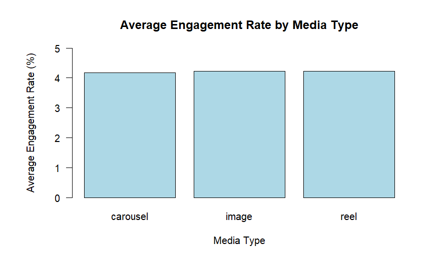
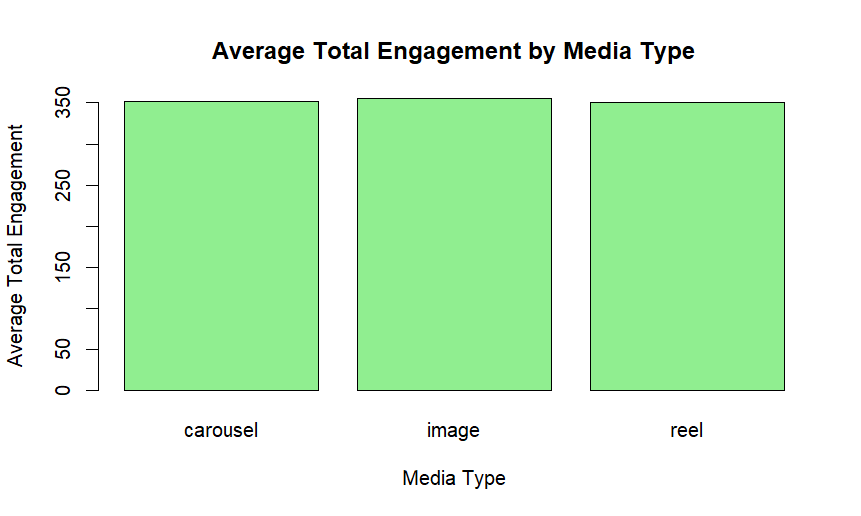

# Instagram Content Engagement Analysis

## Project Overview

This project analyzes Instagram content engagement to explore whether different content formats receive different levels of user engagement.

The analysis was conducted using R as part of my data analytics learning journey.

## Research Question

**Which types of Instagram content receive the highest average user engagement?**

The analysis focuses on three content types:
- Carousel
- Image
- Reel

## Project Objectives

- Explore and understand the dataset.
- Check for missing and duplicated values.
- Calculate total engagement.
- Compare average engagement and engagement rates across content types.
- Apply statistical tests to evaluate potential differences.

## Tools Used

- R
- RStudio
- Base R functions
- Statistical analysis and data visualization

## Methodology

The analysis includes:

1. Data import and exploration
2. Data quality checks
3. Total engagement calculation
4. Mean and median comparisons
5. Data visualization using bar charts
6. Statistical testing:
   - One-way ANOVA
   - Kruskal-Wallis test
   - Fligner-Killeen test

## Key Findings

### Average Engagement Rate

| Content Type | Average Engagement Rate |
|---|---:|
| Carousel | 4.18% |
| Image | 4.23% |
| Reel | 4.23% |

### Average Total Engagement

| Content Type | Average Total Engagement |
|---|---:|
| Carousel | 351.86 |
| Image | 355.53 |
| Reel | 351.06 |

### Statistical Results

- ANOVA p-value: 0.332
- Kruskal-Wallis p-value: 0.4463
- Fligner-Killeen p-value: 0.3022

The statistical tests did not provide sufficient evidence of significant differences in engagement rates between the three content types.

## Conclusion

Image and Reel content showed slightly higher average engagement rates than Carousel content.

However, the differences were not statistically significant. Based on this dataset, no content type can be identified as significantly more engaging than the others.

## Limitations

- The dataset's original source and representativeness have not yet been independently verified.
- The formula used for the existing engagement rate variable has not been independently verified.
- The independence and normality assumptions require further consideration.
- The findings should not be generalized to all Instagram accounts.

## Project Structure

```text
instagram-engagement-analysis/
│
├── README.md
├── analysis.R
├── report.md
│
└── plots/
    ├── average_engagement_rate.png
    └── average_total_engagement.png
```

## Learning Outcomes

Through this project, I practiced:

- Data exploration with R
- Data quality assessment
- Descriptive statistics
- Data visualization
- Statistical hypothesis testing

---

**This project is part of my journey toward becoming a Data Analyst.**

## Visualizations

### Average Engagement Rate



### Average Total Engagement


